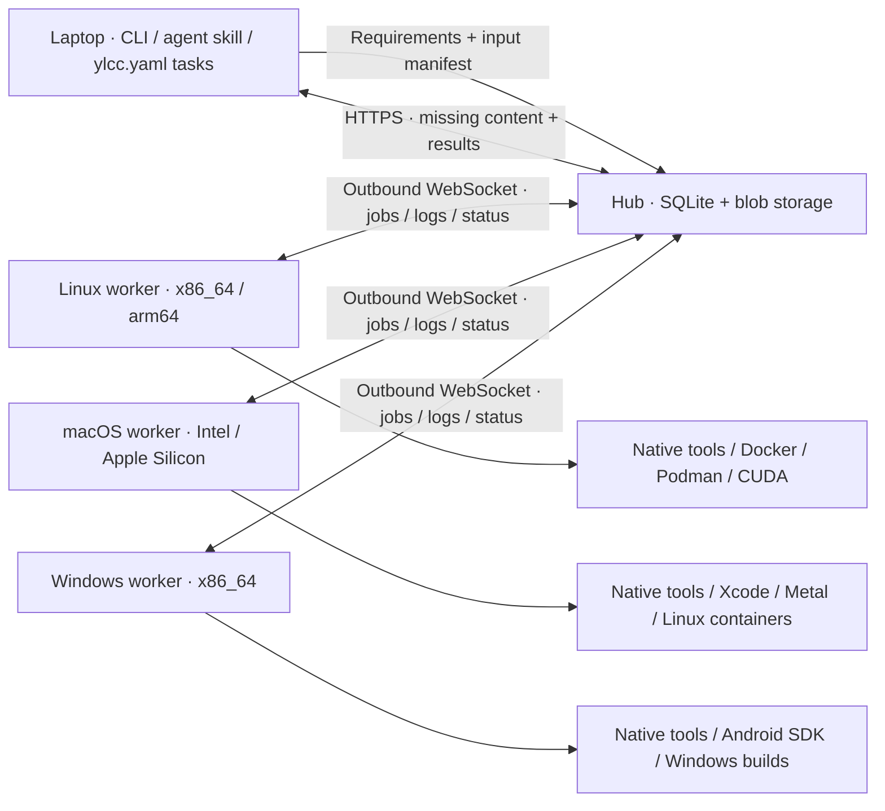

<div align="center">

[English](README.md) | 한국어


# Your Local Cloud Computing

**쉬고 있는 다른 컴퓨터에 일을 맡기세요.**

빌드, 테스트, 렌더링, GPU 워크로드를 CLI나 코딩 에이전트에서 내 Linux, macOS, Windows 머신들에 나눠 실행합니다.

[빠른 시작](#빠른-시작) · [문서](#문서) · [에이전트](docs/ko/agents.md) · [컨테이너](docs/ko/containers.md) · [환경](docs/ko/environments.md) · [MIT](LICENSE)

</div>

YLCC는 작은 자체 호스팅 컴퓨트 풀입니다. 허브 하나, 내 머신들에서 도는 워커, 그리고 요청자(requester) CLI로 구성됩니다. 워커는 허브로 바깥 방향 연결을 맺습니다. 잡 실행 중에 워커의 인바운드 포트나 SSH가 필요하지 않습니다. 머신 간 연결에는 Tailscale Serve 주소 같은 비공개 HTTPS 엔드포인트를 사용하세요.



## 제공 기능

- OS, CPU 아키텍처, 도구 버전, ABI, CPU 기능, GPU 백엔드 요구 조건을 지정할 수 있고, 조건에 맞는 워커가 바쁘면 잡은 대기열에 들어갑니다.
- 기본적으로 선택한 입력만 보내고, 필요하면 프로젝트 전체 스냅샷도 보낼 수 있습니다. SHA-256 기반 콘텐츠 전송으로 없는 블롭만 보냅니다.
- 쓰기 가능한 잡 체크아웃, 원격 재사용 환경, 영구 보존되는 로그, 그리고 별도 잡 디렉터리로 내려받는 선언된 출력물을 제공합니다.
- 네이티브 서비스, Docker/Podman 패키징, 그리고 같은 CLI를 쓰는 에이전트 스킬을 제공합니다. 원격 LLM은 필요 없습니다.

이 풀은 신뢰할 수 있는 사람과 신뢰할 수 있는 코드를 위한 것입니다. 네이티브 잡은 워커 서비스 사용자의 권한으로 실행됩니다. 컨테이너 런타임 소켓을 주면 그 런타임과 마운트된 호스트 자원을 제어할 권한도 함께 주는 셈입니다. 다른 CI 워크로드의 자원 관리는 여전히 머신 소유자의 책임입니다.

## CLI 설치

x86_64/arm64용 Linux/macOS 버전 바이너리를 내려받습니다. 설치 스크립트는 설치 전에 릴리스의 `SHA256SUMS`로 아카이브를 검증합니다.

```bash
task_tmp="$(mktemp -d)"
curl -fL https://raw.githubusercontent.com/semanticist21/your-local-cloud-computing/v0.4.10/scripts/install.sh -o "$task_tmp/install.sh"
bash "$task_tmp/install.sh" --version v0.4.10
rm "$task_tmp/install.sh"
rmdir "$task_tmp"
export PATH="$HOME/.local/bin:$PATH"
ylcc --version
```

설치 옵션, 예제에 쓰이는 [지원 파일](docs/ko/install.md#예제와-에이전트-지원-파일-내려받기), 소스 빌드, 업데이트 방법은 [설치](docs/ko/install.md)에 있습니다. Windows는 [Windows](docs/ko/windows.md)를 참고하세요.

## 빠른 시작

### 1. 허브 시작

항상 켜져 있는 머신에서 토큰과 영구 허브 디렉터리를 만듭니다. `init`은 보호된 토큰 파일을 생성하며, 그 내용을 출력하거나 기존 토큰을 덮어쓰지 않습니다.

```bash
ylcc init
ylcc hub --listen 127.0.0.1:7443 --data-dir "$HOME/.local/share/ylcc/hub"
```

허브는 같은 주소에서 읽기 전용 대시보드를 제공합니다. 허브 머신에서 `http://127.0.0.1:7443/`을 열거나 다른 기기에서 비공개 HTTPS 주소로 접속한 뒤, 브라우저에 풀 토큰을 입력하세요. 대시보드는 워커, 잡, 환경 준비 상태를 보여 주고 5초마다 새로 고칩니다. 토큰은 해당 브라우저 탭에만 보관됩니다.

허브 자체는 TLS를 제공하지 않습니다. 신뢰할 수 없는 네트워크에서 평문 HTTP로 풀 토큰을 보내지 마세요. Tailscale Serve 같은 비공개 HTTPS 엔드포인트를 쓰세요. LAN에서 직접 접속하려면 허브를 접근 가능한 사설 인터페이스에 바인딩하고 호스트 방화벽의 일반적인 제한을 적용하세요.

다른 터미널에서 비공개 네트워크에만 공개합니다. 예를 들어 Tailscale을 설치하고 tailnet에 HTTPS를 켠 경우:

```bash
tailscale serve --bg --https=10000 http://127.0.0.1:7443
```

이후 단계에서는 이렇게 얻은 비공개 `https://HUB.example.ts.net:10000` 주소를 사용합니다. 기존 Serve 설정은 그대로 두고, Funnel은 켜지 마세요. [Tailscale Serve](https://tailscale.com/docs/reference/tailscale-cli/serve)를 참고하세요.

권한이 있는 모든 요청자와 워커는 같은 토큰 파일이 필요합니다. 기존의 안전한 관리 채널로 전달하고, 프로젝트와 이미지 바깥에 두며, `chmod 600`으로 권한을 제한하세요. 기본 위치는 `~/.config/ylcc/token`입니다. 공유 토큰은 풀에서 임의의 워크로드를 실행할 권한을 주므로 신뢰할 수 있는 운영자에게만 배포하세요.

### 2. 워커 연결

각 워커에 CLI를 설치하고 토큰 파일을 둡니다. 그다음:

```bash
export YLCC_HUB_URL=https://HUB.example.ts.net:10000
export YLCC_TOKEN_FILE="$HOME/.config/ylcc/token"
ylcc worker --id linux-build --data-dir "$HOME/.local/share/ylcc/worker" --max-jobs 1
```

워커마다 서로 다른 ID를 쓰세요. 워커 데이터에는 소스 스냅샷, 쓰기 가능한 시도(attempt), 로그, 재사용 환경이 들어갑니다. 원한다면 `--data-dir`을 마운트된 영구 SSD로 지정하세요. 워커는 실제로 실행할 수 있는 것만 보고합니다. Linux 컨테이너 안에서 네이티브 macOS를 광고하지 않습니다.

### 3. 요청자 설정과 작업 실행

노트북에서 같은 URL과 토큰 파일을 설정하고, 이후 세션을 위해 저장합니다.

```bash
ylcc --hub https://HUB.example.ts.net:10000 --token-file "$HOME/.config/ylcc/token" configure
ylcc --json workers
ylcc --json doctor
```

[지원 체크아웃](docs/ko/install.md#예제와-에이전트-지원-파일-내려받기)에서 예제의 전송 매니페스트를 확인하고, 조건에 맞는 워커에서 실행합니다.

```bash
(
  cd "$YLCC_SUPPORT_DIR"
  ylcc manifest --input examples/jobs/hello.rs
  ylcc run --input examples/jobs/hello.rs --os linux --arch x86_64 \
    --tool rustc='*' --output result.json \
    -- sh -c 'rustc examples/jobs/hello.rs -o hello && ./hello'
)
```

워커에 `rustc`가 이미 있어야 하며, 없으면 [등록된 환경](docs/ko/environments.md)을 사용하세요. `--tool NAME=VERSION`은 보고된 버전과 정확히 일치해야 하고, `*`는 감지된 어떤 버전이든 허용합니다. `--build-target`은 툴체인 타깃 요구 조건을 추가할 뿐, 빌드 명령을 바꾸거나 없는 SDK를 자동으로 설치하지 않습니다.

다음으로 분리 실행(detached) 잡, 결과, 입력 규칙은 [잡 실행](docs/ko/jobs.md)을 참고하세요.

## 문서

- [설치](docs/ko/install.md): 설치 옵션, 지원 파일, 소스 빌드, 업데이트
- [Windows](docs/ko/windows.md): Windows 컨테이너, Windows CLI와 워커
- [잡 실행](docs/ko/jobs.md): 분리 실행 잡, 결과, 입력과 실행 규칙
- [프로젝트 태스크](docs/ko/tasks.md): `ylcc.yaml`, 반복 가능한 워크플로, 대기열 제어, 태스크 템플릿
- [백그라운드 서비스](docs/ko/services.md): systemd, launchd, macOS 볼륨과 개인정보 보호
- [Docker와 Podman](docs/ko/containers.md): 컨테이너 워커, 형제 컨테이너 실행
- [재사용 환경](docs/ko/environments.md): 이미지 환경과 네이티브 도구 환경
- [에이전트에서 사용](docs/ko/agents.md): 함께 제공되는 에이전트 스킬
- [GPU와 플랫폼 확인](docs/ko/gpu.md): CUDA, ROCm, Metal, 크로스 플랫폼 빌드
- [진단과 개발](docs/ko/development.md): 문제 해결, 테스트, CI, 릴리스

## 라이선스

YLCC는 [MIT 라이선스](LICENSE)로 독자적으로 구현되었습니다. RCH 코드는 포함하지 않습니다. YLCC에는 MCP, 레지스트리, P2P 데이터 전송, 자동 재시도 엔진, 관련 없는 CI 잡을 위한 스케줄링 예약 기능이 없습니다.
