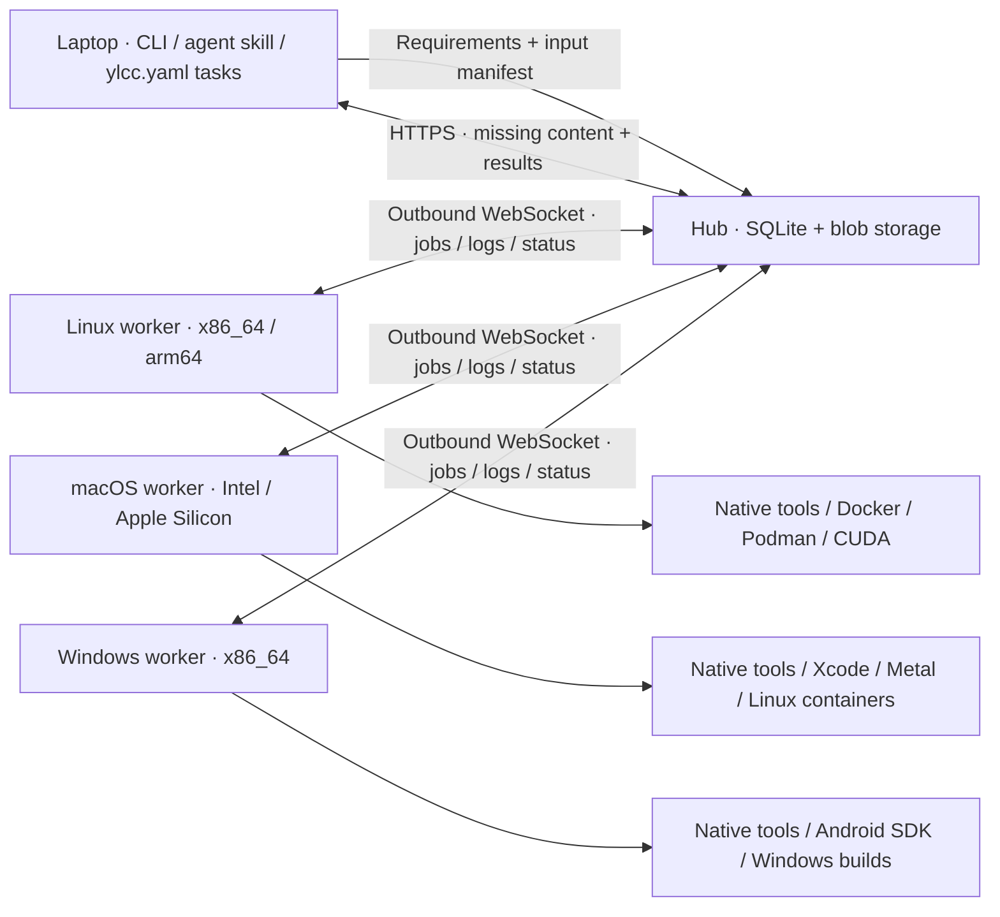
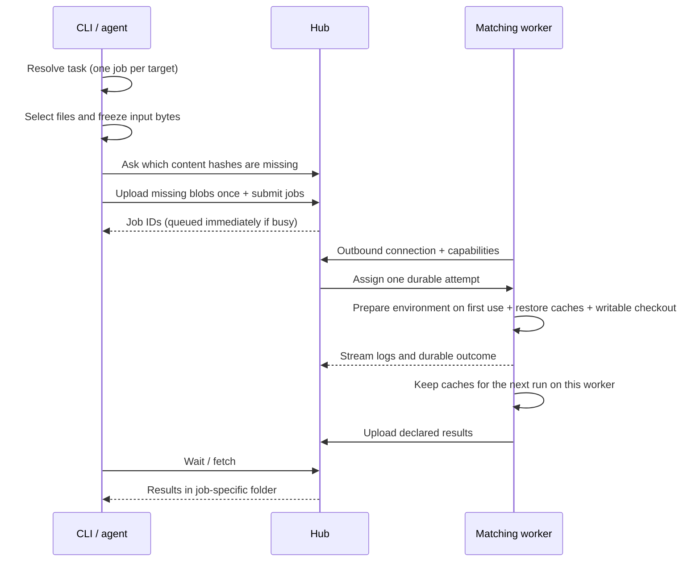

<div align="center">


# Your Local Cloud Computing

**Put your other computers to work.**

Run builds, tests, rendering and GPU workloads across your own Linux, macOS and Windows machines, from a CLI or coding agent.

[Quick start](#quick-start) · [Agents](#use-from-an-agent) · [Containers](#docker-and-podman) · [Environments](#reusable-environments) · [MIT](LICENSE)

</div>

YLCC is a small self-hosted compute pool: one hub, workers on your machines, and a requester CLI. Workers connect outward to the hub. You do not need inbound worker ports or SSH during jobs. Use a private HTTPS endpoint, such as a Tailscale Serve address, to connect machines.



## What you get

- OS, CPU architecture, tool version, ABI, CPU feature and GPU backend requirements; busy matching workers queue jobs.
- Selected inputs by default, optional whole-project snapshots, and SHA-256 content transfer that sends missing blobs only.
- Writable job checkouts, remote reusable environments, durable logs and declared outputs downloaded to a separate job directory.
- Native services, Docker/Podman packaging, and an agent skill that uses the same CLI. No remote LLM is required.

This is a pool for trusted people and trusted code. Native jobs have the worker service user's permissions. A container runtime socket grants control over that runtime and its mounted host resources. Other CI workloads remain the machine owner's resource-management responsibility.

## Install the CLI

Download a versioned binary for Linux/macOS on x86_64/arm64. The installer verifies the archive against the release's `SHA256SUMS` before installing it:

```bash
task_tmp="$(mktemp -d)"
curl -fL https://raw.githubusercontent.com/semanticist21/your-local-cloud-computing/v0.4.4/scripts/install.sh -o "$task_tmp/install.sh"
bash "$task_tmp/install.sh" --version v0.4.4
rm "$task_tmp/install.sh"
rmdir "$task_tmp"
export PATH="$HOME/.local/bin:$PATH"
ylcc --version
```

Use `--prefix /your/prefix` to change the install location. You can also download and check the [release archives](https://github.com/semanticist21/your-local-cloud-computing/releases) yourself. macOS builds are unsigned command-line programs; they are not notarized application bundles. Linux release binaries require glibc 2.35 or newer so native workers can load GPU driver libraries. On musl-based systems such as Alpine, use the container image or build from source for your system; GPU probing additionally requires dynamic library loading. Workload binaries keep their own platform/ABI requirements.

### Download examples and agent support files

The binary installer installs the executable and license notices. Before using the example jobs, environment recipes, Compose/Quadlet files or agent installer below, fetch the matching versioned support checkout outside your application project:

```bash
export YLCC_SUPPORT_DIR="$HOME/.local/share/ylcc/support/v0.4.4"
mkdir -p "$(dirname "$YLCC_SUPPORT_DIR")"
git clone --depth 1 --branch v0.4.4 \
  https://github.com/semanticist21/your-local-cloud-computing.git "$YLCC_SUPPORT_DIR"
```

Keep this directory for the examples below. Reuse it if already cloned; it contains public support files, never your pool token. Commands reference this directory explicitly or run examples in a subshell, preserving your application's working directory.

To build the CLI from this checkout instead of downloading a binary:

```bash
npm ci --prefix "$YLCC_SUPPORT_DIR/dashboard"
npm run build --prefix "$YLCC_SUPPORT_DIR/dashboard"
cargo build --manifest-path "$YLCC_SUPPORT_DIR/Cargo.toml" --locked --release
mkdir -p "$HOME/.local/bin"
install -m 755 "$YLCC_SUPPORT_DIR/target/release/ylcc" "$HOME/.local/bin/ylcc"
```

## Updating an existing installation

Run installer with desired version; config/token/data are preserved.

## Windows containers

The Windows worker image is a **Windows/amd64 Server Core LTSC 2022 container**. It requires a Docker engine in Windows-container mode and a compatible Windows host. The existing Linux image stays separate. Windows images are pending publication; until a Windows image has passed CI and is published, build the source runtime below. Versioned Windows image tags use `VERSION-windows-ltsc2022`, separately from the Linux amd64/arm64 tag.

Microsoft supports the LTSC 2022 image on Windows Server 2022/2025 and Windows 11 with the appropriate isolation mode; consult the [host/image compatibility matrix](https://learn.microsoft.com/en-us/virtualization/windowscontainers/deploy-containers/version-compatibility) and [Windows container prerequisites](https://learn.microsoft.com/en-us/virtualization/windowscontainers/quick-start/set-up-environment). Confirm the selected daemon before installing:

```powershell
docker info --format '{{.OSType}}'  # Must print windows.
```

The image includes YLCC and Windows PowerShell 5.1. Workload tools such as Java, Android command-line SDKs and compilers belong in a custom image. Windows containers support headless commands; they do not provide an Android Studio desktop or an Android Emulator/GUI testing environment. Keep simulator or desktop testing on an appropriate native worker. See Microsoft's [Windows container application limits](https://learn.microsoft.com/en-us/virtualization/windowscontainers/quick-start/lift-shift-to-containers).

From a Windows support checkout, build the binary as described in [Windows CLI and worker](#windows-cli-and-worker), then prepare and build the image:

```powershell
New-Item -ItemType Directory -Path dist -Force | Out-Null
Copy-Item target/release/ylcc.exe,LICENSE,THIRD_PARTY_NOTICES.txt dist/
docker build --file Dockerfile.windows --target runtime --tag ylcc-windows:local .
$env:YLCC_WINDOWS_IMAGE = 'ylcc-windows:local'
```

Use a **dedicated named volume** for worker jobs, environments and the protected token copy. Transfer your existing pool token through the secure administration channel into a private host directory as `pool.token`. Set `$bootstrap` to that directory; the initializer mounts it read-only for this one-time operation. Discover the image's actual unprivileged ContainerUser identity before initialization; the initializer protects only the fixed YLCC volume paths and refuses to replace a different existing token. It never changes the host token's ACL or prints its contents.

```powershell
$env:YLCC_WINDOWS_DATA_VOLUME = 'ylcc-windows-worker'
$env:YLCC_WINDOWS_ISOLATION = 'hyperv'  # Choose a supported mode for your host.
$bootstrap = 'C:\path\to\private-token-folder'
$identityProbe = '$ProgressPreference="SilentlyContinue"; $i=[Security.Principal.WindowsIdentity]::GetCurrent(); @{sid=$i.User.Value; name=$i.Name; admin=(New-Object Security.Principal.WindowsPrincipal($i)).IsInRole([Security.Principal.WindowsBuiltInRole]::Administrator)} | ConvertTo-Json -Compress'
$encodedIdentity = [Convert]::ToBase64String([Text.Encoding]::Unicode.GetBytes($identityProbe))
$workerIdentity = docker run --rm --isolation $env:YLCC_WINDOWS_ISOLATION --user ContainerUser --entrypoint powershell.exe $env:YLCC_WINDOWS_IMAGE -NoProfile -NonInteractive -EncodedCommand $encodedIdentity
if ($LASTEXITCODE -ne 0) { throw 'Cannot discover the image ContainerUser identity.' }
$workerIdentity = $workerIdentity | Out-String | ConvertFrom-Json
if ($workerIdentity.admin -ne $false -or $workerIdentity.name -notmatch '(^|\\)ContainerUser$') { throw 'Expected the unprivileged ContainerUser identity.' }
docker volume create $env:YLCC_WINDOWS_DATA_VOLUME
docker run --rm --isolation $env:YLCC_WINDOWS_ISOLATION --user ContainerAdministrator --mount "type=volume,source=$env:YLCC_WINDOWS_DATA_VOLUME,target=C:\ylcc-data" --mount "type=bind,source=$bootstrap,target=C:\ylcc-bootstrap,readonly" --entrypoint powershell.exe $env:YLCC_WINDOWS_IMAGE -NoProfile -NonInteractive -ExecutionPolicy Bypass -File C:\ylcc\Initialize-WindowsWorker.ps1 -WorkerSid $workerIdentity.sid
```

The initializer is the only step run as ContainerAdministrator. The ongoing worker runs as **ContainerUser** using only the named volume. Its private directories/token allow ContainerUser, SYSTEM and built-in Administrators; they are owned by the built-in Administrators group. No host secret directory is mounted into the ongoing worker. Source snapshots, writable attempts, logs, environment caches and returned files persist under `C:\ylcc-data\worker` when the container is recreated.

Configure the actual private HTTPS Hub URL, a unique worker ID and concurrency, then start the [Windows Compose example](compose.windows.yaml):

```powershell
$env:YLCC_HUB_URL = 'https://HUB.example.ts.net:10000'
$env:YLCC_WORKER_ID = 'windows-container'
$env:YLCC_MAX_JOBS = '1'
# For a tailnet-only Hub, use MagicDNS plus your usual public DNS resolver.
$env:YLCC_WINDOWS_DNS_PRIMARY = '100.100.100.100'
$env:YLCC_WINDOWS_DNS_FALLBACK = 'YOUR_STANDARD_DNS_SERVER'
docker compose -f compose.windows.yaml up -d
docker compose -f compose.windows.yaml logs --tail 40
# Removing the container retains the external named volume:
docker compose -f compose.windows.yaml down
```

The two DNS overrides are optional. Leave them unset when the container's default DNS can resolve the Hub. `100.100.100.100` is Tailscale's device-local [Quad100 DNS resolver](https://tailscale.com/docs/reference/quad100); keep a regular resolver as fallback so public hostnames used by jobs still resolve.

Docker's restart policy manages the worker while the Windows container engine is running. Set up engine startup through your existing Windows runtime. Request `--os windows --arch x86_64` for these jobs; this worker advertises Windows and `containerized: true`. The plain image has no host runtime pipe or nested container engine, and Windows GPU capabilities are not advertised without a working native probe.

## Windows CLI and worker

Windows support is new in the source checkout. Published **v0.2.0 has no Windows binary**; use a checkout containing this support until a Windows release is published. Native Windows x86_64 is supported; Windows arm64 release artifacts and a Windows Hub background service are not provided. The Hub can stay on Linux/macOS, but update it from this support checkout before connecting a Windows worker: the v0.2.0 Hub rejects Windows worker registrations. Windows uses the same outward HTTPS/WebSocket connection and shared token; SSH, WSL and Docker are not required.

To build from source, install [Rust's MSVC toolchain](https://rust-lang.org/tools/install/) and Visual Studio Build Tools with the C++ desktop workload and Windows SDK (SQLite is bundled). In PowerShell, from this checkout:

```powershell
cargo build --locked --release
$ylcc = (Resolve-Path .\target\release\ylcc.exe).Path
& $ylcc --version
```

For a published Windows release, the installer detects x86_64, checks `SHA256SUMS` and validates the ZIP before installing to `$env:LOCALAPPDATA\Programs\ylcc\bin`. From the matching support checkout, replace `RELEASE_TAG` below with a published tag that includes the Windows ZIP (Windows assets are still pending):

```powershell
powershell.exe -NoProfile -ExecutionPolicy Bypass -File .\scripts\install.ps1 -Version RELEASE_TAG
```

`-ExecutionPolicy Bypass` applies only to that child process; it does not change your user or machine execution policy. Organization Group Policy can still restrict execution. The installer places the executable and licenses without changing PATH. Choose a release whose assets actually include `ylcc-windows-x86_64.zip`; the v0.2.0 assets do not. Keep the executable at its installed location after registering a background worker. Windows prevents replacing a running executable: drain jobs and stop/uninstall the worker task before upgrading, then reinstall it with the same ID/data directory.

Transfer your existing pool token through your secure administration channel to `$env:APPDATA\ylcc\token`. Restrict its ACL to your user, SYSTEM and Administrators; `ylcc init` creates a protected token only when setting up a **new** pool. Do not generate a different token on a joining worker. Then configure and start:

```powershell
$token = Join-Path $env:APPDATA 'ylcc\token'
$data = Join-Path $env:LOCALAPPDATA 'ylcc\worker'
& $ylcc --hub https://HUB.example.ts.net:10000 --token-file $token configure
& $ylcc --json doctor
& $ylcc worker --id windows-build --data-dir $data --max-jobs 1
```

After confirming the foreground connection, stop it with Ctrl+C and install the background worker from the same configured user shell:

```powershell
& $ylcc service install --role worker --id windows-build --data-dir $data --max-jobs 1
& $ylcc --json workers
# Inspect only this user's task and service log:
$sid = [System.Security.Principal.WindowsIdentity]::GetCurrent().User.Value
Get-ScheduledTask -TaskName "YLCC-worker-$sid"
Get-Content -LiteralPath (Join-Path $env:LOCALAPPDATA 'ylcc\service\worker.log') -Tail 40
# Remove automatic startup; tokens, logs and workload data are retained:
& $ylcc service uninstall --role worker
```

This is a Task Scheduler task running as the installing user with limited privileges and an interactive logon token. It starts at that user's logon and requires the user to stay logged in; a locked session is fine. It is not a Windows SCM service and does not start before login. Local Task Scheduler policy can reject registration; the command reports the error. The task captures the installing shell's PATH. Reinstall it after changing SDK/tool paths, and check `workers` for the actual service capabilities. Use a local ACL-capable disk such as NTFS for private token/job data; filesystems without working ACL protection are rejected.

From the support checkout, submit the native [PowerShell example](examples/jobs/windows-check.ps1) from any requester:

```bash
ylcc run --input examples/jobs/windows-check.ps1 --os windows --arch x86_64 \
  --output result.json -- powershell.exe -NoProfile -NonInteractive -ExecutionPolicy Bypass -File examples/jobs/windows-check.ps1
```

On Windows PowerShell, put that command on one line instead of using Bash's `\` continuation. Request `windows` explicitly for Windows tools; a Linux container worker on a Windows host advertises Linux. Android builds/emulator jobs additionally require the Android SDK, Java/Gradle and emulator virtualization already configured for the worker user. Run Gradle with `--no-daemon` so the job owns its processes instead of reusing an external daemon. YLCC does not install those tools or provide interactive Android Studio remote desktop control. A build test does not establish emulator or real-device support on your particular PC.

## Quick start

### 1. Start a hub

On an always-on machine, create a token and a persistent hub directory. `init` generates a protected token file and never prints its contents or replaces an existing token.

```bash
ylcc init
ylcc hub --listen 127.0.0.1:7443 --data-dir "$HOME/.local/share/ylcc/hub"
```

The Hub serves its read-only dashboard at the same address. Open `http://127.0.0.1:7443/` on the Hub machine, or use the private HTTPS address from another device, then enter the pool token in the browser. The dashboard shows workers, jobs and environment readiness and refreshes every five seconds. Its token is kept only in that browser tab.

The Hub itself does not provide TLS. Do not send the pool token over plain HTTP on an untrusted network; use a private HTTPS endpoint such as Tailscale Serve. For direct LAN access, bind the Hub to a reachable private interface and apply the host firewall's normal restrictions.

In another terminal, publish only to your private network. For example, with Tailscale installed and HTTPS enabled for your tailnet:

```bash
tailscale serve --bg --https=10000 http://127.0.0.1:7443
```

Use the resulting private `https://HUB.example.ts.net:10000` address below. Keep any existing Serve configuration intact; do not enable Funnel. See [Tailscale Serve](https://tailscale.com/docs/reference/tailscale-cli/serve).

All authorized requesters and workers need the same token file. Transfer it through your existing secure administration channel, keep it outside projects and images, and restrict it with `chmod 600`. The default is `~/.config/ylcc/token`. The shared token authorizes arbitrary pool workloads; only distribute it to trusted operators.

### 2. Connect workers

On each worker, install the CLI and place the token file. Then:

```bash
export YLCC_HUB_URL=https://HUB.example.ts.net:10000
export YLCC_TOKEN_FILE="$HOME/.config/ylcc/token"
ylcc worker --id linux-build --data-dir "$HOME/.local/share/ylcc/worker" --max-jobs 1
```

Use a distinct ID on every worker. Worker data contains source snapshots, writable attempts, logs and reusable environments. Point `--data-dir` to a mounted persistent SSD if desired. The worker reports what it can actually execute; it does not advertise native macOS from inside a Linux container.

### 3. Configure your requester and run work

On your laptop, set the same URL and token file, then save these references for later sessions:

```bash
ylcc --hub https://HUB.example.ts.net:10000 --token-file "$HOME/.config/ylcc/token" configure
ylcc --json workers
ylcc --json doctor
```

From the [support checkout](#download-examples-and-agent-support-files), inspect the example's transfer manifest and execute it on a matching worker:

```bash
(
  cd "$YLCC_SUPPORT_DIR"
  ylcc manifest --input examples/jobs/hello.rs
  ylcc run --input examples/jobs/hello.rs --os linux --arch x86_64 \
    --tool rustc='*' --output result.json \
    -- sh -c 'rustc examples/jobs/hello.rs -o hello && ./hello'
)
```

The worker must already have `rustc` available, or use a [registered environment](#reusable-environments). `--tool NAME=VERSION` requires the reported exact version; `*` accepts any detected version. `--build-target` adds a toolchain target requirement; it does not alter your build command or install a missing SDK automatically.

For asynchronous work, add `--detach` and keep the returned job `id`:

```bash
ylcc jobs show JOB_ID
ylcc jobs logs JOB_ID
ylcc jobs wait JOB_ID
ylcc jobs fetch JOB_ID
ylcc jobs cancel JOB_ID
```

`run` without `--detach`, and `jobs wait`, automatically fetch declared outputs. Results go to `~/.local/share/ylcc/results/JOB_ID/`, configurable with `--results-dir`. `jobs fetch` reports the actual path. Use `--no-download` to leave outputs remote. Results never overwrite your project automatically.

### Input and execution rules



Select files/folders with repeated `--input`, use `--project` for the whole project, or explicitly use `--no-input` for a command requiring no local files. Directory discovery follows Git's ignore rules, while tracked files use their current working content, including uncommitted changes. Explicitly selecting an ignored **file** includes that file only. Inspect `manifest` before including generated files or credentials. Symlinks are rejected rather than followed outside the selection.

Inputs are immutable after submission; changing local files affects the next submission. Each attempt gets a fresh writable checkout. Only declared relative output paths are collected. No implicit heavy local fallback, automatic retry on another worker, or cross-architecture emulation occurs. A disconnected/`unknown` attempt needs inspection before resubmission because its original process may still exist.

## Project tasks

Keep repeatable commands in `ylcc.yaml` in your application repository. The requester uses its existing user-level Hub/token configuration; do not put credentials in this file. Commands and selected paths are relative to the YAML file's directory, even when invoked elsewhere.

```yaml
version: 1
tasks:
  test:
    command: [cargo, test, --locked]
    inputs: [Cargo.toml, Cargo.lock, src, tests]
    requirements:
      os: linux
      arch: x86_64
      tools:
        cargo: "*"
    timeout_secs: 1800
    priority: 0
```

Use your project's actual inputs and command. Add `outputs` for files to download, `environment` for a tool environment, or use `project: true` instead of `inputs` to select the whole project. A command without source inputs must explicitly set `no_input: true`. Project files define executable commands; inspect a new file before running it.

```bash
ylcc task list
ylcc task run test
ylcc task run test --file /path/to/application/ylcc.yaml --detach
```

### Repeatable workflows

A project file can carry everything a run needs, like a CI workflow: shared defaults, the toolchain, per-OS targets and worker-side caches.

```yaml
version: 1
environments:
  bun: {uses: bun@1.3.14}          # Built-in preset; `environment: bun@1.3.14` also works inline.
  tools:                           # Or a full recipe (setup/verify/env, or an image digest).
    setup: ['curl -fsSL https://example.com/tool.tar.gz | tar -xz -C "$YLCC_ENV_DIR/bin"']
    verify: [tool --version]
defaults:
  requirements: {os: linux, arch: x86_64}
  environment: bun
  timeout_secs: 1800
  cache: [node_modules]
tasks:
  test:
    command: [sh, -c, 'bun install --frozen-lockfile && bun test']
    inputs: [package.json, bun.lock, src]
  cargo-test:
    command: [cargo, test, --locked]
    inputs: [Cargo.toml, Cargo.lock, src]
    environment: rust-native       # A name not declared above refers to a Hub-registered environment.
    cache: [target]
    targets:                       # One job per target; each overrides the requirements.
      - {os: linux, arch: x86_64}
      - {os: macos, arch: aarch64}
```

- **Environments** declared in the file are registered when `task run` uses them. Each worker installs one on first use and keeps it, so later runs start immediately. The revision is a hash of the recipe: editing it prepares a new revision, while an unchanged recipe is reused. A custom recipe's Hub id gets a project suffix (for example `tools-3fa2…`), so projects reusing a name never replace each other's recipe or a separately registered environment.
- **Presets** (`bun`, `node`, `rust`, `go`, `uv`) install into the worker's environment directory: a shell recipe on Linux/macOS, a PowerShell recipe on Windows x86_64 (id suffix `-windows`). A preset needs an explicit `os` in the requirements or target to pick its recipe. Rust on Windows links MSVC targets only with Visual Studio Build Tools installed on the host.
- **Defaults** apply to every task that does not set the field itself; `env` maps merge.
- **Targets** submit one job per entry. The snapshot uploads once. `task run` prints one object for one target or an array for several, and fails if any job fails.
- **Cache** directories are moved out of the checkout after the job and back into the next one on the same worker with the same project, environment, container and path. The project is its `name` when set (to share caches between requesters), otherwise the YAML directory's absolute path. Caches are kept after failures too. If another attempt is using a cache, the job runs without it rather than waiting. Caches live under the worker's `caches/` data directory; delete that directory to clear them. A path already present in the inputs is never replaced.

Turn a working ad-hoc run into a task with `--save-task NAME`. It appends to `./ylcc.yaml` (creating it if needed, keeping existing comments) after the job succeeds, or at submission with `--detach`. Inputs and commands stay relative to the current directory. The run is refused before submission if the file's `defaults` would make the saved task run differently:

```bash
ylcc run --input package.json --input bun.lock --input src --os linux --environment bun@1.3.14 \
  --cache node_modules --save-task test -- sh -c 'bun install && bun test'
ylcc task run test
```

YAML version 1 rejects unknown fields and invalid selections. CPU/memory percentage limits are not supported by this schema; configure actual resource caps in the container runtime or operating system. `max_jobs` limits simultaneous jobs, not their CPU or memory consumption.

### Control queued work

The Hub persists the queue and worker controls. Higher numeric priority runs first among compatible queued jobs; equal priorities retain submission order. Priority defaults to `0` and accepts `-100` through `100`. Changing priority never interrupts an assigned or running job.

```bash
ylcc run --no-input --os linux --priority 10 --detach -- true
ylcc jobs priority JOB_ID 20
ylcc workers pause WORKER_ID
ylcc workers resume WORKER_ID
ylcc workers limit WORKER_ID --max-jobs 1
```

Pausing stops new assignments and new environment preparation while existing work finishes. Resume allows scheduling again. A live concurrency limit may be raised only up to the worker's startup `--max-jobs` capacity; lowering it lets active work finish. Set the startup capacity when installing the worker service. Controls survive Hub restarts and worker reconnects. To update safely, pause a worker, wait until its active attempts finish, update it, then resume it. Cancellation remains an explicit per-job operation.

Priority submission requires a Hub advertising priority support; older Hubs are rejected instead of silently ignoring a nonzero priority.

## Background services

Install under the account that should run workloads. On shared managed machines, use a dedicated account without administrative rights; keep management credentials out of that account. Its `HOME`, token, executable/support checkout, tool caches and worker data must reside on filesystems that enforce ownership and permissions. Use mode `600` for tokens and `700` for private directories, and keep executable paths unwritable by unrelated accounts.

```bash
ylcc --hub https://HUB.example.ts.net:10000 --token-file "$HOME/.config/ylcc/token" \
  service install --role worker --id linux-build --data-dir "$HOME/.local/share/ylcc/worker"

# On the hub machine, using its own local listen address:
ylcc service install --role hub --listen 127.0.0.1:7443 --data-dir "$HOME/.local/share/ylcc/hub"
```

Linux uses `systemd --user`: inspect `systemctl --user status ylcc-worker` and `journalctl --user -u ylcc-worker`. An administrator must enable linger with `loginctl enable-linger SERVICE_USER` for startup without login. Installing from a shell requires a working user manager/session bus.

macOS uses a login LaunchAgent by default: `launchctl print gui/$(id -u)/org.ylcc.worker`. Its stdout/stderr logs are `$HOME/Library/Logs/ylcc/service-ROLE.log` and `service-ROLE.err.log`. The user must log in and any external data volume must be mounted. For a dedicated headless account, an administrator can use `service install --system-user SERVICE_USER ...` to install a LaunchDaemon running as that user. System-user logs use `/private/var/log/ylcc/SERVICE_USER/`, with root-owned directories and service-user-owned mode-600 regular files. Prepare an existing user-owned data directory and readable protected token first:

```bash
sudo /absolute/path/to/ylcc --hub https://HUB.example.ts.net:10000 \
  --token-file /absolute/service-home/.config/ylcc/token service install \
  --system-user SERVICE_USER --role worker --id mac-build \
  --data-dir /absolute/persistent-volume/ylcc/worker
```

Service installation captures the current executable location and native user's `PATH`; keep the binary there. System-user macOS installs set a user-specific `HOME` and a standard tool path. After changing tool paths, reinstall the service and verify capabilities under the service account. Updates should wait until active jobs finish before restarting a worker. Never replace running environments mid-job.

Keep launchd stdout/stderr logs on the internal system volume, separate from external job data. macOS can reject opening log paths on removable volumes before starting the executable, producing `posix_spawn: Operation not permitted` or `EX_CONFIG` (78) without a worker log. Check the plist's `StandardOutPath`/`StandardErrorPath` and `launchctl print` when diagnosing this failure; readable external tokens and a valid working directory do not establish that launchd can open those log paths.

An external Mac volume with “Ignore ownership” enabled (`noowners`) cannot enforce this account isolation. A plaintext sparsebundle on that volume does not fix it: other local accounts can read or modify the backing bands regardless of permissions inside the mounted image.

On macOS, an administrator can [add a separate APFS volume](https://support.apple.com/guide/disk-utility/add-delete-or-erase-apfs-volumes-dskua9e6a110/mac) to an existing APFS container, optionally with a quota, and enable ownership on that volume. This permits separate storage without changing a neighboring volume's ownership setting. Use OS tools to prepare and mount the chosen volume, verify that ownership is enforced, then place the service account's files there. Start or restart the worker only after its data volume is available.

macOS [file-access privacy controls](https://support.apple.com/en-nz/guide/security/secddd1d86a6/web) also cover removable volumes. A background LaunchDaemon can be denied access even when the service user owns the directory with mode `700`. An installed CLI, readable token or successful interactive/SSH access does not establish privacy approval for the background service. A denied `worker.lock` create/open is one possible symptom; inspect the worker error and macOS privacy logs before changing permissions.

For a standalone native worker denied removable-volume access, a Mac administrator can open **System Settings → Privacy & Security → Full Disk Access**, click **+**, add the installed `ylcc` executable at the fixed path used by the service plist (for example `/usr/local/bin/ylcc`), and enable it. Restart the worker and verify external-data writes and a real job through that LaunchDaemon. Use the macOS approval UI; leave TCC databases and SIP settings untouched. After updating an unsigned or ad-hoc-signed executable, re-check access in the actual service context.

Remove the user service with `ylcc service uninstall --role worker` (or `hub`). This retains tokens and workload data; remove those explicitly only when no longer needed. System-user LaunchDaemon removal uses `service uninstall --role worker --system-user SERVICE_USER` as an administrator.

## Docker and Podman

The worker image supports Linux amd64 and arm64. It includes YLCC, CA certificates, Git, Bash and curl; workload tools belong in reusable environments or your own image. The plain image has no runtime socket or nested container daemon.

Use your existing Docker or Podman runtime. On macOS, an existing [OrbStack](https://docs.orbstack.dev/docker/) or Docker Desktop installation can run the Linux worker; YLCC requires no second VM. Select the intended Docker context explicitly for each command instead of changing the global context. Keep the runtime's image cache on its configured disk, and bind-mount worker data from an external ownership-enforced volume when desired. Confirm the selected runtime can access that mount and the protected token as the intended user.

Using the [support checkout](#download-examples-and-agent-support-files), publish the Compose hub only on host loopback and bind persistent directories owned by your current user. The worker shares the hub's network namespace and connects over its loopback, keeping plaintext HTTP local. Preserve the token's owner-only mode:

```bash
docker context ls
export YLCC_DOCKER_CONTEXT="$(docker context show)"
# To select an existing OrbStack context explicitly: export YLCC_DOCKER_CONTEXT=orbstack
docker --context "$YLCC_DOCKER_CONTEXT" info
export YLCC_UID="$(id -u)" YLCC_GID="$(id -g)"
export YLCC_DATA_DIR="$HOME/.local/share/ylcc/containers"
# For external work data, choose an already mounted ownership-enforced volume:
# export YLCC_DATA_DIR=/Volumes/YourOwnedVolume/ylcc/containers
export YLCC_TOKEN_FILE="$HOME/.config/ylcc/token"
mkdir -p "$YLCC_DATA_DIR/hub" "$YLCC_DATA_DIR/worker"
docker --context "$YLCC_DOCKER_CONTEXT" compose -f "$YLCC_SUPPORT_DIR/compose.yaml" up -d
```

The worker connects to `http://127.0.0.1:7443` inside the shared network namespace. To join an existing private hub instead, run only a worker with a persistent data mount:

```bash
mkdir -p "$YLCC_DATA_DIR/worker"
docker --context "$YLCC_DOCKER_CONTEXT" run -d --init --name ylcc-worker --restart unless-stopped \
  --user "$YLCC_UID:$YLCC_GID" \
  --mount "type=bind,src=$YLCC_DATA_DIR/worker,dst=/data" \
  --mount "type=bind,src=$YLCC_TOKEN_FILE,dst=/run/secrets/token,readonly" \
  ghcr.io/semanticist21/your-local-cloud-computing:0.2.0 \
  --hub https://HUB.example.ts.net:10000 --token-file /run/secrets/token \
  worker --id container-worker --data-dir /data --max-jobs 1
```

For rootless Podman service management, copy `$YLCC_SUPPORT_DIR/examples/quadlet/ylcc-worker.container` ([example](examples/quadlet/ylcc-worker.container)) to `~/.config/containers/systemd/`, replace the hub URL and worker ID, then `systemctl --user daemon-reload && systemctl --user start ylcc-worker`. Its keep-id mapping lets the service read your mode-600 token. See [Podman Quadlet](https://docs.podman.io/en/latest/markdown/podman-systemd.unit.5.html).

### Optional sibling-container execution

Native workers can use an already configured Docker or Podman runtime; verify its context and socket access under the worker service account's `HOME`. To request a workload image, pass `--container IMAGE`, or use an image environment. A containerized worker needs an explicitly installed runtime client and access to the host runtime. Build the optional client target from a matching release binary:

```bash
mkdir -p "$YLCC_SUPPORT_DIR/dist"
# Extract the verified Linux release archive for the runtime CPU; arm64 example:
tar -xzf /path/to/ylcc-linux-aarch64.tar.gz -C "$YLCC_SUPPORT_DIR/dist"
docker --context "$YLCC_DOCKER_CONTEXT" build --target runtime-client -t ylcc-runtime-client:0.2.0 \
  -f "$YLCC_SUPPORT_DIR/Dockerfile" "$YLCC_SUPPORT_DIR"
```

Mount the daemon socket explicitly and add the socket's group to the worker. **This grants the worker control of that host runtime.** Bind-mount the worker data directory at the **same absolute path** on host and worker, and pass that path as `--data-dir`; sibling container mounts are resolved by the host daemon, not the worker container. This profile uses a client only, never Docker-in-Docker. Docker Desktop path sharing and rootless Podman socket permissions must also allow the chosen paths/user.

For a Docker socket, set `YLCC_RUNTIME_SOCKET` to its absolute path and `YLCC_RUNTIME_GID` to its numeric group ID, then:

```bash
: "${YLCC_RUNTIME_SOCKET:?Set the Docker socket path}" "${YLCC_RUNTIME_GID:?Set its numeric group ID}"
export YLCC_RUNTIME_DATA="$HOME/.local/share/ylcc/runtime-worker"
mkdir -p "$YLCC_RUNTIME_DATA"
docker --context "$YLCC_DOCKER_CONTEXT" run -d --init --name ylcc-runtime-worker --restart unless-stopped \
  --user "$(id -u):$(id -g)" --group-add "$YLCC_RUNTIME_GID" \
  --mount "type=bind,src=$YLCC_RUNTIME_SOCKET,dst=/var/run/docker.sock" \
  --mount "type=bind,src=$YLCC_RUNTIME_DATA,dst=$YLCC_RUNTIME_DATA" \
  --mount "type=bind,src=$YLCC_TOKEN_FILE,dst=/run/secrets/token,readonly" \
  ylcc-runtime-client:0.2.0 \
  --hub https://HUB.example.ts.net:10000 --token-file /run/secrets/token \
  worker --id runtime-worker --data-dir "$YLCC_RUNTIME_DATA" --max-jobs 1
```

Build custom workload images outside YLCC, push them to GHCR/Forgejo or another registry, and register their immutable digest. Runtime credentials stay with the service user; they do not belong in the environment catalog.

## Reusable environments

Register and prepare Rust, Node or Python image environments from the [support checkout](#download-examples-and-agent-support-files):

```bash
ylcc env add "$YLCC_SUPPORT_DIR/examples/environments/rust.json"
ylcc env prepare rust-linux --worker linux-build
ylcc env status
(
  cd "$YLCC_SUPPORT_DIR"
  ylcc run --input examples/jobs/hello.rs --os linux --arch x86_64 \
    --environment rust-linux --output result.json \
    -- sh -c 'rustc examples/jobs/hello.rs -o hello && ./hello'
)
```

The example image references are pinned multi-platform digests. Use [Node](examples/environments/node.json) or [Python](examples/environments/python.json) similarly. Image environments execute on a worker with a usable container runtime; Docker on macOS still runs Linux. Images are pulled and verified in the actual execution environment, and resolved digests/readiness are stored per worker.

For native Linux/macOS tools, [the rustup recipe](examples/environments/rust-native.json) installs a pinned toolchain into the environment's user-owned directory. Project-specific recipes can use existing version managers such as mise, a release binary, or Git clone/build commands. Commands receive `YLCC_ENV_DIR`, with its `bin` directory prepended to `PATH`; environment values expand `${YLCC_ENV_DIR}` and `${PATH}`. Keep install steps repeatable and versioned, and provide `verify` commands that fail when the expected tools are unusable.

Use a new `revision` when changing an environment, then `env add` and `env prepare` explicitly. `ylcc env delete ID` removes an environment from the catalogue with its statuses and preparation logs; it succeeds when the id is already gone and refuses while queued or active jobs use it. Files already prepared on workers stay in their data directories; past jobs keep their recorded environment, and retrying one needs the id registered again. Preparation/update is serialized and drains active work on the worker. Jobs can prepare their requested native environment when first used. Image environments are immutable: put setup in the image Dockerfile, not a disposable setup command. Persistent environment/cache data lives under the worker data directory and must be mounted for a container worker. Updating a worker image is an explicit pull/recreate after jobs drain, with these mounts retained.

Installing an API CLI does not authenticate it. Supply required credentials through the service user's existing secure configuration. Drivers, system SDKs and Xcode remain host setup; the tool does not change them automatically.

## Use from an agent

Install the CLI, configure the requester, [download the support files](#download-examples-and-agent-support-files), and install the bundled skill globally or per project:

```bash
bash "$YLCC_SUPPORT_DIR/scripts/install-skill.sh" --global
# Or:
bash "$YLCC_SUPPORT_DIR/scripts/install-skill.sh" --project /path/to/project
```

Start a new agent session. For Codex, skills are discovered from `~/.agents/skills` or the project's `.agents/skills`; the included skill permits normal automatic selection. See [Codex skills](https://learn.chatgpt.com/docs/customization/overview#skills). Other agents supporting the open skill format can load [skills/ylcc/SKILL.md](skills/ylcc/SKILL.md) from their documented skill directory.

Ask naturally: “Build this on a Linux x86_64 worker and bring back the binary,” or explicitly invoke `$ylcc`. The skill discovers workers, chooses requirements and selected inputs, submits asynchronously, checks logs/status and downloads declared results. It does not add an MCP server or run another agent on the worker.

Try these natural prompts after installing the skill:
- "Check the pool and workers, but don't run anything."
- "Run this only on a powered Windows x86_64 worker."
- "Build this on Linux x86_64 and bring back the binary."
- "Use the reviewed `ylcc.yaml` build task, then await and fetch its result."
- "Open the dashboard without giving me the token in chat."


## GPU and platform checks

Programs must actually use the requested GPU backend. `--gpu cuda`, `--gpu rocm` and `--gpu metal` select distinct capabilities; they do not translate CPU code or pool GPU memory over the network. Check `workers` and run an actual workload to validate device/driver access under the service account. Container GPU execution additionally needs the host's NVIDIA/CDI or ROCm runtime configuration.

From the [support checkout](#download-examples-and-agent-support-files), the [CUDA driver example](examples/jobs/cuda.py) performs GPU vector addition using Python's standard library and an installed NVIDIA driver. The [Metal example](examples/jobs/metal.swift) dispatches a Metal compute kernel:

```bash
(
  cd "$YLCC_SUPPORT_DIR"
  ylcc run --input examples/jobs/cuda.py --os linux --arch x86_64 --gpu cuda \
    --output result.json -- python3 examples/jobs/cuda.py
  ylcc run --input examples/jobs/metal.swift --os macos --arch aarch64 --gpu metal \
    --output result.json -- swift examples/jobs/metal.swift
)
```

macOS/Xcode work requires a native Mac worker and the appropriate SDK. Requesting Linux x86_64 from an Apple Silicon laptop selects a matching worker; it does not make the result a macOS executable. Cross-compilation needs the relevant linker/sysroot/SDK and an explicit build command. Emulation is not implemented in v0.2.0.

## Setup and fast task templates

Run first-run discovery without printing secrets:

```bash
ylcc setup
ylcc examples
```

Create a project task file in the current application repository. Runtime templates declare a preset environment and cache:

```bash
ylcc task init --runtime bun --name test --file ylcc.yaml
ylcc task init --runtime rust --name test --file ylcc.yaml
ylcc task list
ylcc task run test --detach
```

Reuse a prepared environment before trusting it:

```bash
ylcc env status
ylcc env ensure my-tools --worker WORKER_ID
```

## Diagnose and develop

`ylcc doctor` reports local capabilities and configured workers. Check service logs, actual service-account `PATH`, token permissions, private HTTPS reachability and container runtime access first. A worker connection loss is distinct from command failure. Persist the hub database/blob directory and worker data; do not delete an unknown attempt's files while its process may still be running.

```bash
(
  cd "$YLCC_SUPPORT_DIR"
  cargo test --locked
  bash scripts/test-install.sh
  cargo build --locked --release
)
```

CI builds/tests on native Linux x86_64, Linux arm64, Intel macOS, Apple Silicon macOS and Windows x86_64. Windows installer checks run under Windows PowerShell 5.1. Windows container CI uses a Server 2022 Docker engine, initializes a disposable named volume, runs/fetches a real ContainerUser job, cancels a descendant process and checks persistence after recreation. Release automation creates four Unix archives plus a Windows ZIP, checksums, a Linux multi-platform image, a separate Windows LTSC 2022 image and a draft GitHub Release for final real-machine validation. Published release availability and successful local hardware tests are separate checks.

YLCC is independently implemented under the [MIT license](LICENSE). It does not incorporate RCH code. v0.2.0 does not include MCP, a registry, peer-to-peer data transfer, an automatic retry engine, or scheduling reservations for unrelated CI jobs.
