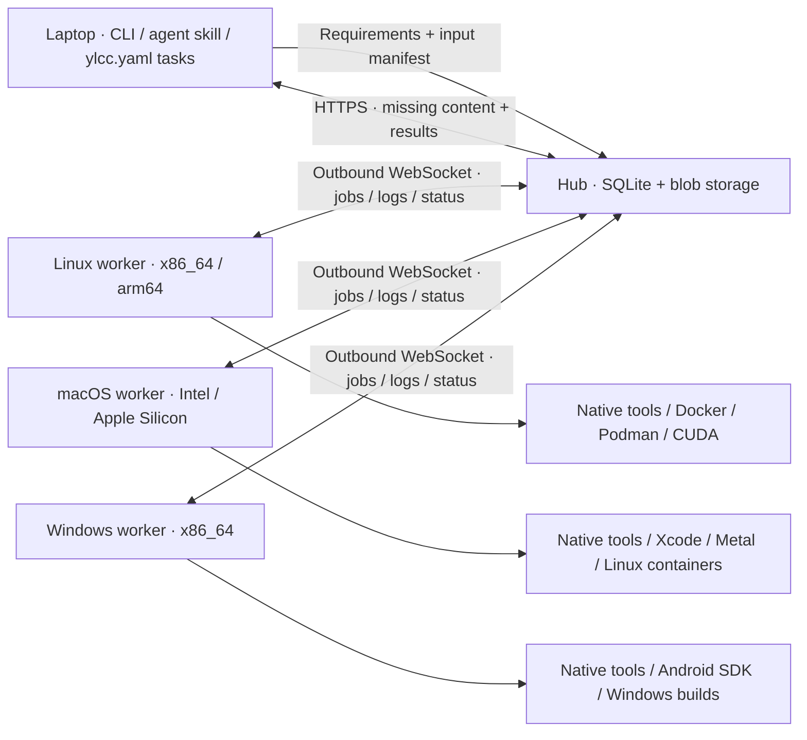

<div align="center">

English | [한국어](README.ko.md)


# Your Local Cloud Computing

**Put your other computers to work.**

Let your coding agent run builds, tests, rendering and GPU jobs on your own Linux, macOS and Windows machines.

[](https://github.com/semanticist21/your-local-cloud-computing/actions/workflows/ci.yml) [](https://github.com/semanticist21/your-local-cloud-computing/releases/latest)


[Quick start](#quick-start) · [Docs](#documentation) · [Agents](docs/agents.md) · [Containers](docs/containers.md) · [Environments](docs/environments.md) · [MIT](LICENSE)

</div>

YLCC is a small self-hosted compute pool: one hub, workers on your machines, and a requester CLI. Workers connect outward to the hub. You do not need inbound worker ports or SSH during jobs. Use a private HTTPS endpoint, such as a Tailscale Serve address, to connect machines.



## What you get

- OS, CPU architecture, tool version, ABI, CPU feature and GPU backend requirements; busy matching workers queue jobs.
- Selected inputs by default, optional whole-project snapshots, and SHA-256 content transfer that sends missing blobs only.
- Writable job checkouts, remote reusable environments, durable logs and declared outputs downloaded to a separate job directory.
- Native services, Docker/Podman packaging, and an agent skill that uses the same CLI. No remote LLM is required.

## Security model

YLCC is a pool for trusted people and trusted code: one person or a small team sharing their own machines, not multi-tenant CI.

- **Who can run jobs?** Anyone holding an admin or requester token. The Hub's original pool token is the admin root; issue each machine its own [role token](docs/security.md#roles) (admin, requester or worker) so you can revoke one machine without touching the rest. Requesters still see every job, log and output, and can run arbitrary code on workers, so give them only to trusted operators.
- **What is recorded?** Token, job, worker-control and environment changes go to an [audit log](docs/security.md#audit-log) that admins can read with `ylcc audit` or in the dashboard. Each job records who submitted it.
- **Can a worker refuse work?** Optionally. A [command policy](docs/security.md#worker-command-policy) allowlists commands, images, environments and env keys. It limits which program starts, not what it does: build tools run code from their inputs. It is defence in depth, not a sandbox; use containers for isolation.
- **What can a job touch?** Native jobs run with the worker service user's permissions; use a dedicated non-admin account on shared machines ([Services](docs/services.md)). A container runtime socket grants control over that runtime and its mounted host resources.
- **How is traffic protected?** The Hub has no TLS of its own. Put it behind a private HTTPS endpoint such as Tailscale Serve, never a public one. Workers only connect outward; they open no inbound ports.
- **Who limits resources?** The machine owner. Concurrency is a job count, not a CPU or memory cap.

## Install the CLI

Download a versioned binary for Linux/macOS on x86_64/arm64. The installer verifies the archive against the release's `SHA256SUMS` before installing it:

```bash
task_tmp="$(mktemp -d)"
curl -fL https://raw.githubusercontent.com/semanticist21/your-local-cloud-computing/v0.5.0/scripts/install.sh -o "$task_tmp/install.sh"
bash "$task_tmp/install.sh" --version v0.5.0
rm "$task_tmp/install.sh"
rmdir "$task_tmp"
export PATH="$HOME/.local/bin:$PATH"
ylcc --version
```

Install options, the [support files](docs/install.md#download-examples-and-agent-support-files) used by the examples, building from source and updating are in [Installation](docs/install.md). For Windows, see [Windows](docs/windows.md).

## Quick start

### 1. Start a hub

On an always-on machine, create a token and a persistent hub directory. `init` generates a protected token file and never prints its contents or replaces an existing token.

```bash
ylcc init
ylcc hub --listen 127.0.0.1:7443 --data-dir "$HOME/.local/share/ylcc/hub"
```

The Hub serves its read-only dashboard at the same address. Open `http://127.0.0.1:7443/` on the Hub machine, or use the private HTTPS address from another device, then enter the pool token or a requester token in the browser. The dashboard shows workers, jobs and environment readiness and refreshes every five seconds. Its token is kept only in that browser tab. Admins also see the audit log and issued tokens.

Do not send the pool token over plain HTTP on an untrusted network. For direct LAN access, bind the Hub to a reachable private interface and apply the host firewall's normal restrictions.

In another terminal, publish only to your private network. For example, with Tailscale installed and HTTPS enabled for your tailnet:

```bash
tailscale serve --bg --https=10000 http://127.0.0.1:7443
```

Use the resulting private `https://HUB.example.ts.net:10000` address below. Keep any existing Serve configuration intact; do not enable Funnel. See [Tailscale Serve](https://tailscale.com/docs/reference/tailscale-cli/serve).

The pool token is the admin root of the pool. The quick start below shares it with every machine, which keeps working unchanged, but on anything beyond a personal pool issue each worker and requester its own token with `ylcc tokens create` ([Security](docs/security.md#tokens)). Transfer token files through your existing secure administration channel, keep them outside projects and images, and restrict them with `chmod 600`. The default is `~/.config/ylcc/token`.

### 2. Connect workers

On each worker, install the CLI and place the token file. Then:

```bash
export YLCC_HUB_URL=https://HUB.example.ts.net:10000
export YLCC_TOKEN_FILE="$HOME/.config/ylcc/token"
ylcc worker --id linux-build --data-dir "$HOME/.local/share/ylcc/worker" --max-jobs 1
```

Use a distinct ID on every worker. Worker data contains source snapshots, writable attempts, logs and reusable environments. Point `--data-dir` to a mounted persistent SSD if desired. The worker reports what it can actually execute; it does not advertise native macOS from inside a Linux container.

### 3. Configure your requester and run work

On your laptop, set the same URL and token file, then save these references for later sessions:

```bash
ylcc --hub https://HUB.example.ts.net:10000 --token-file "$HOME/.config/ylcc/token" configure
ylcc --json workers
ylcc --json doctor
```

From the [support checkout](docs/install.md#download-examples-and-agent-support-files), inspect the example's transfer manifest and execute it on a matching worker:

```bash
(
  cd "$YLCC_SUPPORT_DIR"
  ylcc manifest --input examples/jobs/hello.rs
  ylcc run --input examples/jobs/hello.rs --os linux --arch x86_64 \
    --tool rustc='*' --output result.json \
    -- sh -c 'rustc examples/jobs/hello.rs -o hello && ./hello'
)
```

The worker must already have `rustc` available, or use a [registered environment](docs/environments.md). `--tool NAME=VERSION` requires the reported exact version; `*` accepts any detected version. `--build-target` adds a toolchain target requirement; it does not alter your build command or install a missing SDK automatically.

Next, see [Running jobs](docs/jobs.md) for detached jobs, results and input rules.

## Documentation

- [Installation](docs/install.md): install options, support files, building from source, updating
- [Windows](docs/windows.md): Windows containers, Windows CLI and worker
- [Running jobs](docs/jobs.md): detached jobs, results, input and execution rules
- [Project tasks](docs/tasks.md): `ylcc.yaml`, repeatable workflows, queue control, task templates
- [Background services](docs/services.md): systemd, launchd, macOS volumes and privacy
- [Docker and Podman](docs/containers.md): container workers, sibling-container execution
- [Reusable environments](docs/environments.md): image and native tool environments
- [Use from an agent](docs/agents.md): the bundled agent skill
- [Security](docs/security.md): role tokens, audit log, worker command policy
- [GPU and platform checks](docs/gpu.md): CUDA, ROCm, Metal, cross-platform builds
- [Diagnose and develop](docs/development.md): troubleshooting, tests, CI and releases

## License

YLCC is independently implemented under the [MIT license](LICENSE). It does not incorporate RCH code. YLCC does not include MCP, a registry, peer-to-peer data transfer, an automatic retry engine, or scheduling reservations for unrelated CI jobs.
