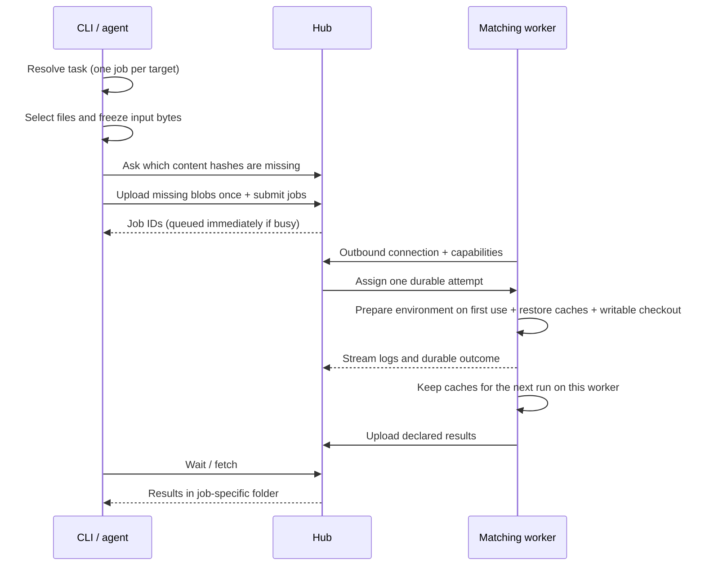

English | [한국어](ko/jobs.md)

# Running jobs

## Asynchronous jobs

For asynchronous work, add `--detach` and keep the returned job `id`:

```bash
ylcc jobs show JOB_ID
ylcc jobs logs JOB_ID [--follow]
ylcc jobs wait JOB_ID
ylcc jobs fetch JOB_ID
ylcc jobs cancel JOB_ID
```

`run` without `--detach`, and `jobs wait`, automatically fetch declared outputs. Results go to `~/.local/share/ylcc/results/JOB_ID/`, configurable with `--results-dir`. `jobs fetch` reports the actual path. Use `--no-download` to leave outputs remote. Results never overwrite your project automatically.

`jobs show` reports `waiting` with `wait_reason` until the worker starts the command; the reason names the current step, such as `Fetching job inputs 1200/7780 (45.0 MB of 270.0 MB, 7780 to download)`. It then reports `started_at` and `last_output_at` (Unix seconds, updated at most every 5 s) to tell a slow job from a stalled one. Logs carry only the command's stdout/stderr; print progress there (for example `cmd 2>&1 | tee out/log.txt`) rather than only into a file. `--worker ID` pins a job to one worker; `--tool NAME` accepts any detected version.

A timeout or cancel sends SIGTERM to the command's process group and SIGKILL 30 s later, so `trap cleanup EXIT TERM` can release external resources such as simulators (Windows terminates the job object immediately). Declared outputs that exist when a job fails, times out or is cancelled are still collected.

## Input and execution rules



Select files/folders with repeated `--input`, use `--project` for the whole project, or explicitly use `--no-input` for a command requiring no local files. Directory discovery follows Git's ignore rules, while tracked files use their current working content, including uncommitted changes. Explicitly selecting an ignored **file** includes that file only. A `*` in the last path component (`build/*.dylib`) selects the matching files in that directory, ignored or not, and fails when nothing matches; use it for generated files whose names change with versions. Inspect `manifest` before including generated files or credentials. Symlinks are rejected rather than followed outside the selection.

Inputs are immutable after submission; changing local files affects the next submission. Each attempt gets a fresh writable checkout. Only declared relative output paths are collected. No implicit heavy local fallback, automatic retry on another worker, or cross-architecture emulation occurs. A disconnected/`unknown` attempt needs inspection before resubmission because its original process may still exist.
