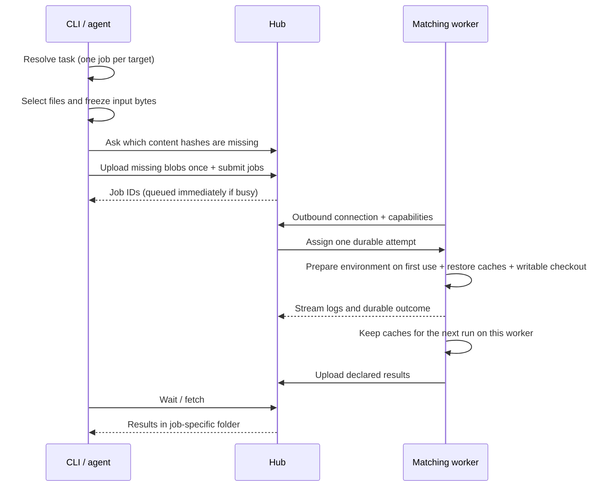

English | [한국어](ko/jobs.md)

# Running jobs

## Asynchronous jobs

For asynchronous work, add `--detach` and keep the returned job `id`:

```bash
ylcc jobs show JOB_ID
ylcc jobs logs JOB_ID [--follow]
ylcc jobs wait JOB_ID
ylcc jobs fetch JOB_ID
ylcc jobs cancel JOB_ID
```

`run` without `--detach`, and `jobs wait`, automatically fetch declared outputs. Results go to `~/.local/share/ylcc/results/JOB_ID/`, configurable with `--results-dir`. `jobs fetch` reports the actual path. Use `--no-download` to leave outputs remote. Results never overwrite your project automatically.

`jobs wait` gives transient Hub errors and an `unknown` attempt up to 60 seconds to recover. It follows the same job ID throughout. If the CLI exits, run `jobs wait JOB_ID` again. Artifact transfers retry transient interruptions and skip local files that already match the declared checksum.

On a Hub advertising `idempotent_job_submit`, the CLI retries an uncertain submission within the same invocation using a separate request key per target. If the outcome is still unclear, check `jobs list` before submitting again. `jobs retry` deliberately creates a new job. Older Hubs receive a single submission.

`jobs show` and the dashboard show why a job is queued or waiting for its worker to start. `wait_reason_code` identifies the cause and `wait_reason` contains the display text. After the command starts, `started_at` and `last_output_at` (Unix seconds, updated at most every 5 s) help distinguish a slow job from a stalled one. Logs carry only the command's stdout/stderr, so print progress there (for example `cmd 2>&1 | tee out/log.txt`). `--worker ID` pins a job to one worker. `--tool NAME` accepts any detected version.

A timeout or cancel sends SIGTERM to the command's process group and SIGKILL 30 s later, so `trap cleanup EXIT TERM` can release external resources such as simulators (Windows terminates the job object immediately). Declared outputs that exist when a job fails, times out or is cancelled are still collected.

## Submission API

Send the existing job spec to `POST /v1/jobs/idempotent` with a UUID in the `Idempotency-Key` header. For 24 hours, the same authenticated requester, key and spec return the current job. A different spec returns HTTP 409. A replay after the job was deleted returns HTTP 410 within that window. `POST /v1/jobs` creates a fresh job on every call.

## Input and execution rules



Select files/folders with repeated `--input`, use `--project` for the whole project, or explicitly use `--no-input` for a command requiring no local files. Directory discovery follows Git's ignore rules, while tracked files use their current working content, including uncommitted changes. Explicitly selecting an ignored **file** includes that file only. A `*` in the last path component (`build/*.dylib`) selects the matching files in that directory, ignored or not, and fails when nothing matches; use it for generated files whose names change with versions. Inspect `manifest` before including generated files or credentials. Symlinks are rejected rather than followed outside the selection.

Inputs are immutable after submission; changing local files affects the next submission. Each attempt gets a fresh writable checkout. Only declared relative output paths are collected. No implicit heavy local fallback, automatic retry on another worker, or cross-architecture emulation occurs. A disconnected/`unknown` attempt needs inspection before resubmission because its original process may still exist.
