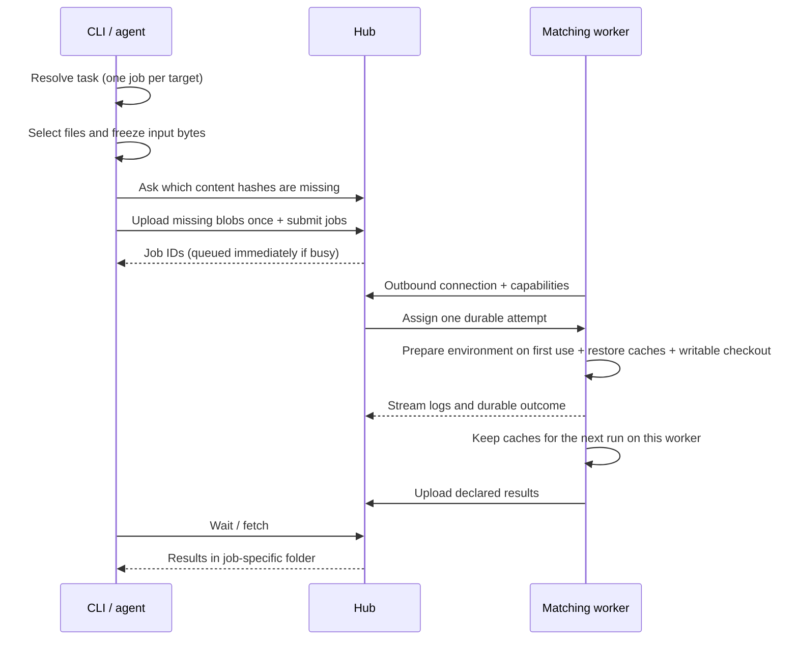

[English](../jobs.md) | 한국어

# 잡 실행

## 비동기 잡

비동기로 실행하려면 `--detach`를 붙이고 반환된 잡 `id`를 보관하세요.

```bash
ylcc jobs show JOB_ID
ylcc jobs logs JOB_ID
ylcc jobs wait JOB_ID
ylcc jobs fetch JOB_ID
ylcc jobs cancel JOB_ID
```

`--detach` 없는 `run`과 `jobs wait`는 선언된 출력물을 자동으로 가져옵니다. 결과는 `~/.local/share/ylcc/results/JOB_ID/`에 저장되며 `--results-dir`로 바꿀 수 있습니다. `jobs fetch`는 실제 경로를 알려 줍니다. 출력물을 원격에 그대로 두려면 `--no-download`를 쓰세요. 결과가 프로젝트를 자동으로 덮어쓰는 일은 없습니다.

## 입력과 실행 규칙



`--input`을 반복해 파일/폴더를 선택하거나, 프로젝트 전체에는 `--project`를, 로컬 파일이 필요 없는 명령에는 명시적으로 `--no-input`을 쓰세요. 디렉터리 탐색은 Git의 ignore 규칙을 따르며, 추적 중인 파일은 커밋하지 않은 변경을 포함한 현재 작업 내용을 사용합니다. 무시된 **파일**을 명시적으로 선택하면 그 파일만 포함됩니다. 생성된 파일이나 자격 증명을 포함하기 전에 `manifest`로 확인하세요. 심볼릭 링크는 선택 범위 밖으로 따라가지 않고 거부됩니다.

입력은 제출 후 변경되지 않습니다. 로컬 파일을 바꾸면 다음 제출에 반영됩니다. 시도마다 새로운 쓰기 가능한 체크아웃을 받습니다. 선언된 상대 출력 경로만 수집됩니다. 암묵적인 무거운 로컬 폴백, 다른 워커에서의 자동 재시도, 아키텍처 간 에뮬레이션은 일어나지 않습니다. 연결이 끊긴/`unknown` 상태의 시도는 원래 프로세스가 아직 살아 있을 수 있으므로, 다시 제출하기 전에 확인이 필요합니다.
